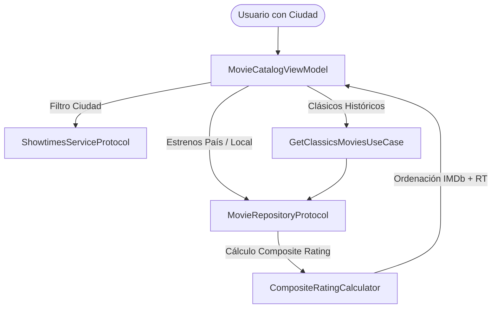

# Plan de Implementación: Cartelera Local por Ciudad y Clásicos por Cruce de Ratings (IMDb + Rotten Tomatoes)

## Descripción del Objetivo
Evolucionar el catálogo de **MovieSocialApp** en dos ejes fundamentales solicitados por el usuario:
1. **Pestaña Estrenos (Cartelera Local por Ciudad):** Determinar qué películas están activas en cines localmente según la ciudad de registro o preferencia del usuario.
2. **Pestaña Clásicos (Catálogo Histórico Ordenado por Rating):** Permitir explorar y seleccionar cualquier película de la historia del cine, ordenada por un **cruce ponderado de calificaciones (IMDb + Rotten Tomatoes)**.

---

## ✅ Decisiones y Acuerdos Confirmados con el Usuario
1. **Cartelera Local por Ciudad:** Arquitectura de servicio desacoplada ([`ShowtimesServiceProtocol`](file:///Users/vctormnzn/Local/software_projects/antigravityProjects/MovieSocialApp/Sources/Features/Movies/Domain/ShowtimesServiceProtocol.swift)) con cines reales por ciudades (Madrid, Barcelona, Bogotá, CDMX, Buenos Aires, etc.), listo para conectar a APIs comerciales (MovieGlu / RapidAPI) cuando se disponga de claves de producción.
2. **Fórmula del Cruce de Calificaciones:**
   * **50% IMDb** (normalizado a escala 0-100).
   * **30% Rotten Tomatoes Críticos** (*Tomatometer*).
   * **20% Rotten Tomatoes Audiencia** (*Popcornmeter*).
   * Generación de `compositeScore` en escala decimal 1.0 - 10.0 con manejo proporcional si falta algún valor.
3. **Selección de Ciudad:** Campo `city` en [`User`](file:///Users/vctormnzn/Local/software_projects/antigravityProjects/MovieSocialApp/Sources/Features/Auth/Domain/User.swift) con selector interactivo rápido (`📍 Ciudad`) en la cabecera de la pestaña *Estrenos*.
4. **Navegación de Clásicos:** Catálogo histórico ordenado de mayor a menor por el rating cruzado, con barra de filtros por décadas (*1920-1960*, *70s*, *80s*, *90s*, *2000s*, *2010s*, *Todas*).

---

## 🔍 Análisis de Viabilidad Técnica: Cartelera Local por Ciudad

> [!IMPORTANT]
> **Conclusión sobre viabilidad:** Es **totalmente viable**, pero requiere distinguir entre el nivel de agregación de TMDB y los servicios de cartelera cinematográfica local (*Showtimes*).

### Limitación de la API de TMDB
* El endpoint `/movie/now_playing` de TMDB soporta el parámetro `region` únicamente a nivel de **país (código ISO 3166-1 alpha-2)** (ej. `region=ES` para España, `region=MX` para México, `region=CO` para Colombia).
* TMDB **no provee** datos de horarios ni cines físicos a nivel de ciudad o sala de proyección.

### Solución Arquitectónica Recomendada
Para mantener una arquitectura limpia, escalable y sin acoplamiento a un único proveedor comercial:
1. **Modelo de Usuario y Preferencias de Ubicación:**
   - Incorporar `city` (ciudad, ej. "Madrid", "Barcelona", "Bogotá", "Ciudad de México") y `countryCode` (ej. "ES", "CO", "MX") en el modelo [`User`](file:///Users/vctormnzn/Local/software_projects/antigravityProjects/MovieSocialApp/Sources/Features/Auth/Domain/User.swift).
   - Permitir al usuario cambiar o alternar su ciudad activa directamente desde la cabecera de la pestaña de *Estrenos*.
2. **Capa de Abstracción de Cartelera (`ShowtimesServiceProtocol`):**
   - Definir un servicio desacoplado que consulte la disponibilidad local:
     - **Modo Producción:** Conectable a APIs de carteleras reales como **MovieGlu API**, **RapidAPI Cinema Showtimes** o scrapers de cadenas de cines.
     - **Modo Catálogo Curado / Mock Dinámico:** Base de datos local realista con cines por ciudad para desarrollo, pruebas y funcionamiento offline sin cuotas de pago de terceros.
3. **Indicador Visual en la Ficha y Tarjeta:**
   - Badge "En cartelera en [Ciudad]" con indicador de salas o disponibilidad.

---

## 🎯 Cruce de Calificaciones: Rotten Tomatoes + IMDb

### Estructura de Datos Actual
Actualmente [`ExternalRatings`](file:///Users/vctormnzn/Local/software_projects/antigravityProjects/MovieSocialApp/Sources/Features/Movies/Domain/Models/ExternalRatings.swift) contiene:
* `rottenTomatoesCritics`: 0 - 100% (Tomatometer).
* `rottenTomatoesAudience`: 0 - 100% (Popcornmeter).
* `imdbScore`: 1.0 - 10.0 (Escala decimal).
* `imdbVotes`: Volumen de votos (ej. "1.8M").

### Algoritmo de Cruce Ponderado (*Blended Rating*)
Para ordenar "cualquier película de la historia", definimos una métrica normalizada de 0 a 10 (o porcentaje 0-100%) denominada **`compositeScore`** (*Score MovieSocial*):

```text
IMDb normalizado = imdbScore * 10 (escala 0 - 100)
Rotten Tomatoes promedio = (Tomatometer + Popcornmeter) / 2

Score Combinado (0 - 100) = (IMDb normalizado * 0.50) + (Tomatometer * 0.30) + (Popcornmeter * 0.20)
Score en base 10 = Score Combinado / 10.0
```
*Si alguno de los valores no está disponible, el cálculo se ajusta proporcionalmente entre los disponibles para no penalizar a obras maestras antiguas que carezcan de audiencia digital masiva o críticas agregadas en RT.*

---

## Cambios Propuestos en el Código



---

### Core / DesignSystem y Dominio de Películas

#### [MODIFY] [`ExternalRatings.swift`](file:///Users/vctormnzn/Local/software_projects/antigravityProjects/MovieSocialApp/Sources/Features/Movies/Domain/Models/ExternalRatings.swift)
- Agregar propiedad calculada `compositeScore: Double?` (escala 1.0 a 10.0) y `formattedCompositeScore: String?`.
- Agregar función para personalizar la ponderación (críticos vs audiencia vs IMDb).

#### [MODIFY] [`Movie.swift`](file:///Users/vctormnzn/Local/software_projects/antigravityProjects/MovieSocialApp/Sources/Features/Movies/Domain/Models/Movie.swift)
- Agregar propiedades de cartelera local opcionales:
  - `isInTheatersLocally: Bool`
  - `theatersPlaying: [String]` (nombres de cines locales donde se proyecta).

#### [NEW] [`CinemaShowtime.swift`](file:///Users/vctormnzn/Local/software_projects/antigravityProjects/MovieSocialApp/Sources/Features/Movies/Domain/Models/CinemaShowtime.swift)
- Estructura que representa una sala de cine, horarios y ciudad para una película dada.

#### [NEW] [`ShowtimesServiceProtocol.swift`](file:///Users/vctormnzn/Local/software_projects/antigravityProjects/MovieSocialApp/Sources/Features/Movies/Domain/ShowtimesServiceProtocol.swift)
- Protocolo para consultar películas en cartelera por ciudad:
  ```swift
  public protocol ShowtimesServiceProtocol: Sendable {
      func getMoviesInTheaters(city: String, countryCode: String) async throws -> [String: [CinemaShowtime]]
      func getAvailableCities() -> [String]
  }
  ```

#### [NEW] [`ShowtimesServiceImpl.swift`](file:///Users/vctormnzn/Local/software_projects/antigravityProjects/MovieSocialApp/Sources/Features/Movies/Data/ShowtimesServiceImpl.swift)
- Implementación actor con catálogo curado por ciudades (Madrid, Barcelona, Bogotá, CDMX, Buenos Aires, etc.) y soporte para conexión a API externa de showtimes.

---

### Módulo Auth & Usuario

#### [MODIFY] [`User.swift`](file:///Users/vctormnzn/Local/software_projects/antigravityProjects/MovieSocialApp/Sources/Features/Auth/Domain/User.swift)
- Agregar campos `city: String?` y `countryCode: String?` al usuario.

---

### Módulo Movies (Repositorio, Casos de Uso y ViewModels)

#### [MODIFY] [`MovieRepositoryProtocol.swift`](file:///Users/vctormnzn/Local/software_projects/antigravityProjects/MovieSocialApp/Sources/Features/Movies/Domain/MovieRepositoryProtocol.swift)
- Extender `getNowPlaying(city: String?, countryCode: String?, page: Int)`
- Extender `getClassics(decade: Int?, sortByRating: Bool, page: Int)`

#### [MODIFY] [`MovieRepositoryImpl.swift`](file:///Users/vctormnzn/Local/software_projects/antigravityProjects/MovieSocialApp/Sources/Features/Movies/Data/MovieRepositoryImpl.swift)
- Conectar llamada a TMDB Discover con filtros de ordenación histórica:
  `sort_by=vote_average.desc&vote_count.gte=500`.
- Ordenar las películas devueltas utilizando el algoritmo `compositeScore` (cruce RT + IMDb).
- Enriquecer el catálogo curado histórico con más obras universales de diferentes épocas (desde los años 20/30 hasta los 2010s).

#### [MODIFY] [`MovieCatalogViewModel.swift`](file:///Users/vctormnzn/Local/software_projects/antigravityProjects/MovieSocialApp/Sources/Features/Movies/Presentation/ViewModels/MovieCatalogViewModel.swift)
- Añadir estados observables:
  - `selectedCity: String` (con selector de ciudad en el header).
  - `selectedDecadeFilter: String?` para Clásicos (ej. "Todos", "Clásicos 1920-1960", "70s", "80s", "90s", "2000s").
  - `classicsSortOption: ClassicsSortOption` (Cruce IMDb+RT, Solo IMDb, Solo Rotten Tomatoes).
- Actualizar `loadCatalog()` para refrescar en base a la ciudad y criterios de ordenación.

#### [MODIFY] [`MovieCatalogView.swift`](file:///Users/vctormnzn/Local/software_projects/antigravityProjects/MovieSocialApp/Sources/Features/Movies/Presentation/Views/MovieCatalogView.swift)
- En **Estrenos**: Agregar selector de ciudad (Píldora interactiva: *"📍 Madrid"*) que permite filtrar o cambiar de ciudad en 1 tap.
- En **Clásicos**: Agregar barra de ordenación y filtro de época, mostrando el badge con la puntuación combinada destacada.

---

## Plan de Verificación

### Pruebas Automatizadas
1. **Pruebas de Cálculo de Puntuación Cruzada (`CompositeRatingTests.swift`):**
   - Verificar que una película con Rotten Tomatoes 95% e IMDb 9.0 tenga el score cruzado correcto.
   - Manejo de casos de borde (películas sin puntuación de audiencia o sin RT).
2. **Pruebas de Repositorio y Filtro Local (`MovieRepositoryShowtimesTests.swift`):**
   - Verificar filtrado por ciudad y disponibilidad en cartelera.
3. **Ejecución de la suite completa:**
   ```bash
   ./test.sh
   ```

### Verificación Manual
1. Abrir la pestaña de **Estrenos**, cambiar la ciudad de "Madrid" a "Bogotá" o "CDMX" y confirmar que se actualizan las películas en cartelera local.
2. Abrir la pestaña de **Clásicos**, verificar que las películas aparecen ordenadas de mayor a menor según el cruce IMDb + Rotten Tomatoes.
3. Probar los filtros por década o búsqueda histórica.
